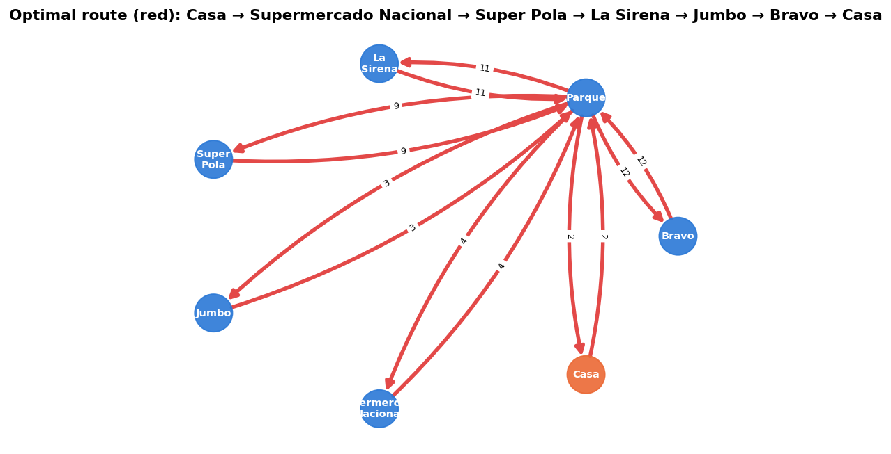
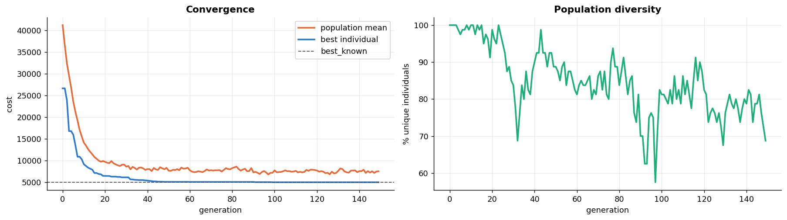
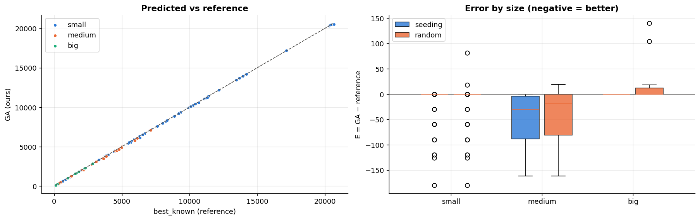
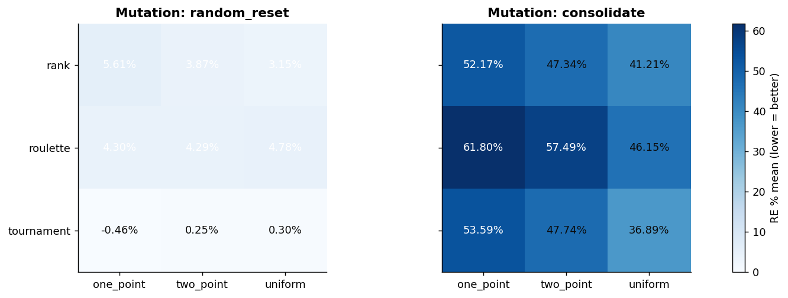
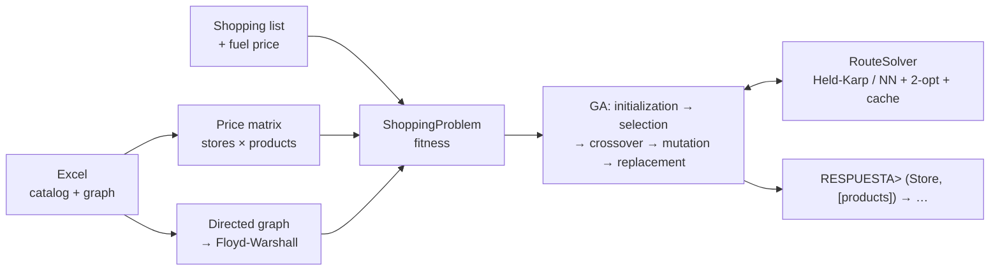

<div align="center">

[🇪🇸 Español](README.md) · **🇬🇧 English**

# 🧬🛒 Genetic Shopping

**Supermarket shopping-route optimization with Genetic Algorithms**




</div>

I have a shopping list and several store branches. Each one sells different products at different prices and sits
at some distance from my home and from the others. **Where should I buy each product, and in what order should I
visit the stores, to spend the least** (products + fuel)?

This project solves it with a **genetic algorithm** built from scratch, validates it against a dataset of 136 problems
with reference solutions, and documents the whole process step by step in a notebook.

📓 **Step-by-step notebook:** [English](notebooks/compra_genetica_en.ipynb) · [Español](notebooks/compra_genetica_es.ipynb)

---

## ✨ Results

| Metric (136 problems) | GA — this project | Greedy cheapest + optimal route (this project) | Reference GA | Greedy cheapest (ref.) |
|---|---|---|---|---|
| Matches or beats the best reference | **100 %** | 91.9 % | 40.6 % | 77.9 % |
| Mean absolute error (MAE) | **16.8**\* | 17.4 | 1,773.2 | 11.3 |
| Mean absolute percentage error (MAPE) | **0.35 %** | 0.73 % | 48.7 % | 0.60 % |
| Exact optimum on small problems | **100 / 100** | — | — | — |

\* The GA's error is **negative**: on 30 problems it finds solutions **cheaper** than the best known reference
(2,286 saved in total). That is why its "absolute error" is not zero.

**Where does the improvement come from?** To be honest, a good part comes from solving the **route** properly. A
greedy as simple as "buy where it's cheapest", if it then orders the stores optimally, already matches or beats the
reference in 91.9 % of the cases. The GA closes the rest (100 %) by finding the cases where paying a bit more for a
product saves a trip. In this dataset prices weigh far more than fuel, so that margin is small but real.

- ✅ The cost model reproduces **504/504** reference solutions to the cent.
- ⚡ A small problem takes ~0.1 s and a medium one ~3 s. The full validation runs in ~25 s in parallel.

<p align="center">
  <br>
  <br>
  
</p>

## 🧠 How it works



## 🧩 Design decisions (and why)

| Decision | Why |
|---|---|
| **The gene is the store for each product**, not the whole route | Each gene only accepts stores that sell that product, so any crossover or mutation yields a valid purchase. No penalties or repairs needed. |
| **The visiting order comes from a heuristic (TSP)** outside the chromosome | Once you know *which* stores to visit, the best order can be computed exactly. Putting it in the chromosome would only blow up the search space. |
| **Exact Held-Karp up to 9 stores, nearest neighbor + 2-opt above** | Held-Karp is $O(2^n n^2)$: perfect for short routes, which are the ones that turn out good. 2-opt covers the rare cases without blowing up the time. |
| **Route cache keyed by store set** | Many different chromosomes visit the same stores. The cache hits ≈ 99 % on small problems. |
| **Directed graph + Floyd-Warshall** | Some streets have different lengths each way. With an undirected graph only 224 of 504 reference solutions match; with a directed one, all 504. |
| **Seeding with two greedy solutions** | Avoids wasting generations rediscovering the obvious and guarantees we never end up worse than them. Measured with and without seeding so the GA's merit isn't inflated. |
| **Exact optimum via store subsets** ($2^S$) | We needed a reliable yardstick: the "quasi brute force" reference turned out not to be always optimal. |
| **Parallelism with joblib across problems, not GPU** | With 80 individuals the GPU loses to NumPy. Measured: it only wins from ~10⁴ individuals. |

| Operator | Implemented options | Benchmark winner |
|---|---|---|
| Selection | tournament · roulette · linear rank | **tournament** (roulette exerts almost no pressure: costs differ little in proportion) |
| Crossover | one-point · two-point · uniform | barely matters |
| Mutation | random reset · consolidation | **random reset** (consolidation causes premature convergence: ≈ 49 % error vs ≈ 3 %) |
| Replacement / termination | elitism · max generations + patience | without elitism the error rises to ≈ 4.5 % |

## 🚀 Usage

```bash
git clone <repo-url> && cd CompraGenetica
pip install -e ".[notebook,dev]"

compra-genetica --catalog data/in/small-3s-4p-f1_10-q1_4-random_catalog.xlsx \
                --products "Purificadores de aire,Aceite de girasol,Pasta de dientes,Alfombras" --fuel 1
```
```
RESPUESTA> (Jumbo, [Aceite de girasol, Pasta de dientes]) -> (Supermercado Nacional, [Purificadores de aire, Alfombras])
Total cost: 11270.96  (products 11244.96 + transport 26.00)
```

```python
from compra_genetica import load_instance, ShoppingProblem, GeneticShoppingOptimizer

problem = ShoppingProblem(load_instance("data/in/small-5s-10p-f0_10-q1_10-parque_catalog.xlsx"),
                          ["Vino tinto", "Edredones"], fuel_price=5)
result = GeneticShoppingOptimizer(problem, selection="tournament", mutation="random_reset", seed=1).run()
print(result.answer, result.best_cost)
```

Hyperparameters: `pop_size`, `generations`, `pc`, `pm`, `selection`, `crossover`, `mutation`, `tournament_k`,
`rank_pressure`, `elitism`, `patience`, `seeding`, `seed` (see `compra-genetica --help`).

**Excel format:** sheet 1 `store | product | price`, sheet 2 `edge 1 | edge 2 | distance`. The home node is `Casa`.

## 🗂️ Structure

```
├── notebooks/            step-by-step notebook (ES / EN), executed with all outputs
├── src/compra_genetica/  package: data, routing, fitness, operators, optimizer, baselines, metrics, gpu, cli
├── tests/                pytest: cost model (504 references), Floyd-Warshall, Held-Karp, operators, CLI
├── data/                 problemset.xlsx + catalogs in data/in/
├── results/              validation and benchmark CSVs + figures
├── tools/                build_notebooks.py: builds and runs both notebooks from a single source
└── pyproject.toml        installable package + compra-genetica command
```

```bash
pytest -q                                     # 24 tests (also run on GitHub Actions)
python tools/build_notebooks.py               # rebuild the notebooks reusing results/*.csv (~1 min)
python tools/build_notebooks.py --recompute   # also recompute the heavy experiments (~15 min)
```

## 🔭 Future work
Memetic GA (local search on the best individual) · adaptive parameters · distributed island model ·
multi-objective NSGA-II (cost vs distance) · massive GPU GA with PyTorch · quantities, opening hours and offers.

## 👤 Author
**Juan I. Almonte Fernández**

## 📄 License
[MIT](LICENSE)
