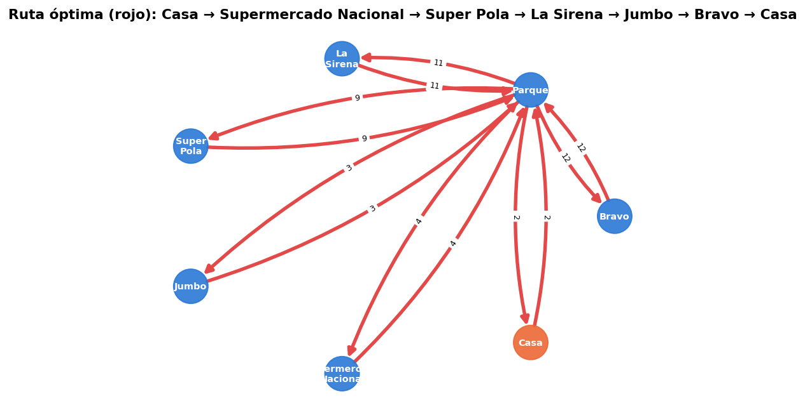
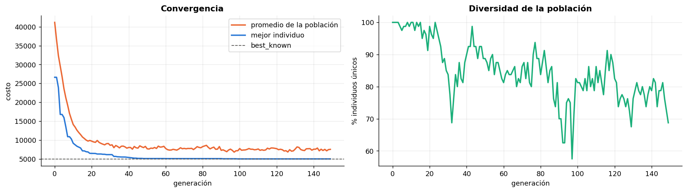
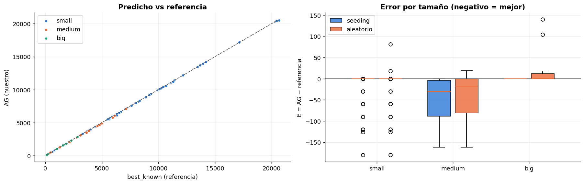
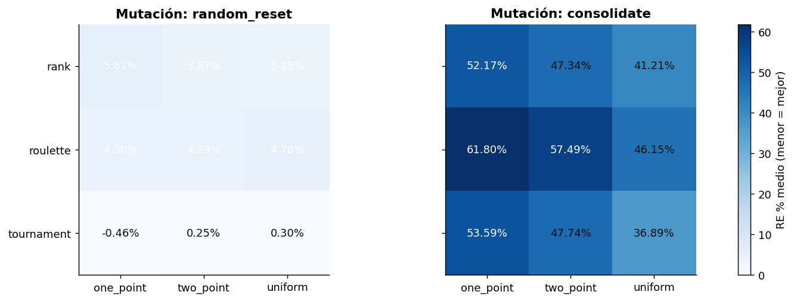
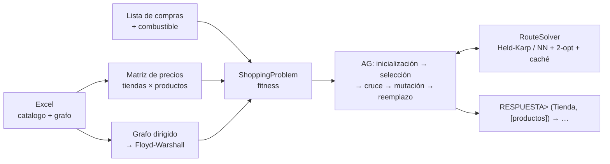

<div align="center">

**🇪🇸 Español** · [🇬🇧 English](README.en.md)

# 🧬🛒 Compra Genética

**Optimización de rutas de compra en supermercados con Algoritmos Genéticos**




</div>

Tengo una lista de compras y varias sucursales. Cada una vende productos distintos a precios distintos y está a
cierta distancia de mi casa y de las demás. **¿Dónde compro cada producto y en qué orden visito las tiendas para
gastar lo mínimo** (productos + combustible)?

Este proyecto lo resuelve con un **algoritmo genético** implementado desde cero, lo valida contra un dataset de 136
problemas con soluciones de referencia y documenta todo el proceso paso a paso en un notebook.

📓 **Notebook paso a paso:** [Español](notebooks/compra_genetica_es.ipynb) · [English](notebooks/compra_genetica_en.ipynb)

---

## ✨ Resultados

| Métrica (136 problemas) | AG — este proyecto | Greedy barato + ruta óptima (este proyecto) | AG de referencia | Greedy barato (ref.) |
|---|---|---|---|---|
| Iguala o supera a la mejor referencia | **100 %** | 91.9 % | 40.6 % | 77.9 % |
| Error absoluto medio (MAE) | **16.8**\* | 17.4 | 1,773.2 | 11.3 |
| Error porcentual medio (MAPE) | **0.35 %** | 0.73 % | 48.7 % | 0.60 % |
| Óptimo exacto en problemas pequeños | **100 / 100** | — | — | — |

\* El error del AG es **negativo**: en 30 problemas encuentra soluciones **más baratas** que la mejor referencia
conocida (ahorro acumulado de 2,286). Por eso su "error absoluto" no es cero.

**¿De dónde sale la mejora?** Siendo honesto, buena parte viene de resolver **bien la ruta**. Un greedy tan simple
como "compra donde es más barato", si después ordena las tiendas de forma óptima, ya iguala o supera a la referencia
en el 91.9 % de los casos. El AG cierra el resto (100 %) porque encuentra los casos donde conviene pagar un poco más
por un producto para ahorrarse un viaje. En este dataset los precios pesan mucho más que el combustible, así que ese
margen es pequeño pero real.

- ✅ El modelo de costo reproduce **504/504** soluciones de referencia al centavo.
- ⚡ Un problema pequeño se resuelve en ~0.1 s y uno mediano en ~3 s. La validación completa corre en ~25 s en paralelo.

<p align="center">
  <br>
  <br>
  
</p>

## 🧠 Cómo funciona



## 🧩 Decisiones de diseño (y por qué)

| Decisión | Por qué |
|---|---|
| **El gen es la tienda de cada producto**, no la ruta completa | Cada gen solo acepta tiendas que venden ese producto, así que cualquier cruce o mutación produce una compra válida. No hacen falta penalizaciones ni reparaciones. |
| **El orden de visita lo calcula una heurística (TSP)** fuera del cromosoma | Sabiendo *qué* tiendas visitar, el mejor orden se puede calcular exacto. Meterlo en el cromosoma solo agrandaba el espacio de búsqueda. |
| **Held-Karp exacto hasta 9 tiendas, vecino más cercano + 2-opt arriba** | Held-Karp es $O(2^n n^2)$: perfecto para rutas cortas, que son las que de verdad salen buenas. 2-opt cubre los casos raros sin disparar el tiempo. |
| **Caché de rutas por conjunto de tiendas** | Muchos cromosomas distintos visitan las mismas tiendas. La caché acierta ≈ 99 % en los problemas pequeños. |
| **Grafo dirigido + Floyd-Warshall** | Hay calles con ida y vuelta de distinto largo. Con el grafo no dirigido solo cuadran 224 de 504 soluciones de referencia; con el dirigido, las 504. |
| **Seeding con dos greedy** | Evita gastar generaciones redescubriendo lo obvio y garantiza no terminar peor que ellos. Se mide con y sin seeding para no inflar el mérito del AG. |
| **Óptimo exacto por subconjuntos de tiendas** ($2^S$) | Hacía falta una vara de medir confiable: la referencia "cuasi fuerza bruta" resultó no ser siempre óptima. |
| **Paralelismo con joblib entre problemas, no GPU** | Con 80 individuos la GPU pierde contra NumPy. Se midió: solo gana desde ~10⁴ individuos. |

| Operador | Opciones implementadas | Ganador en el benchmark |
|---|---|---|
| Selección | torneo · ruleta · ranking lineal | **torneo** (la ruleta casi no ejerce presión: los costos difieren poco en proporción) |
| Cruce | un punto · dos puntos · uniforme | casi da igual |
| Mutación | reinicio aleatorio · consolidación | **reinicio aleatorio** (la consolidación causa convergencia prematura: ≈ 49 % de error contra ≈ 3 %) |
| Reemplazo / término | elitismo · máximo de generaciones + paciencia | sin elitismo el error sube a ≈ 4.5 % |

## 🚀 Uso

```bash
git clone <url-del-repo> && cd CompraGenetica
pip install -e ".[notebook,dev]"

compra-genetica --catalog data/in/small-3s-4p-f1_10-q1_4-random_catalog.xlsx \
                --products "Purificadores de aire,Aceite de girasol,Pasta de dientes,Alfombras" --fuel 1
```
```
RESPUESTA> (Jumbo, [Aceite de girasol, Pasta de dientes]) -> (Supermercado Nacional, [Purificadores de aire, Alfombras])
Total cost: 11270.96  (products 11244.96 + transport 26.00)
```

```python
from compra_genetica import load_instance, ShoppingProblem, GeneticShoppingOptimizer

problem = ShoppingProblem(load_instance("data/in/small-5s-10p-f0_10-q1_10-parque_catalog.xlsx"),
                          ["Vino tinto", "Edredones"], fuel_price=5)
result = GeneticShoppingOptimizer(problem, selection="tournament", mutation="random_reset", seed=1).run()
print(result.answer, result.best_cost)
```

Hiperparámetros: `pop_size`, `generations`, `pc`, `pm`, `selection`, `crossover`, `mutation`, `tournament_k`,
`rank_pressure`, `elitism`, `patience`, `seeding`, `seed` (ver `compra-genetica --help`).

**Formato del Excel:** hoja 1 `store | product | price`, hoja 2 `edge 1 | edge 2 | distance`. La casa se llama `Casa`.

## 🗂️ Estructura

```
├── notebooks/            notebook paso a paso (ES / EN), ejecutado con todos sus resultados
├── src/compra_genetica/  paquete: data, routing, fitness, operators, optimizer, baselines, metrics, gpu, cli
├── tests/                pytest: modelo de costo (504 referencias), Floyd-Warshall, Held-Karp, operadores, CLI
├── data/                 problemset.xlsx + catálogos en data/in/
├── results/              CSVs de validación y benchmarks + figuras
├── tools/                build_notebooks.py: genera y ejecuta ambos notebooks desde una sola fuente
└── pyproject.toml        paquete instalable + comando compra-genetica
```

```bash
pytest -q                                     # 24 tests (también corren en GitHub Actions)
python tools/build_notebooks.py               # regenera los notebooks reutilizando results/*.csv (~1 min)
python tools/build_notebooks.py --recompute   # recalcula también los experimentos pesados (~15 min)
```

## 🔭 Mejoras futuras
AG memético (búsqueda local sobre el mejor individuo) · parámetros adaptativos · modelo de islas distribuido ·
NSGA-II multiobjetivo (costo vs distancia) · AG masivo en GPU con PyTorch · cantidades, horarios y ofertas.

## 👤 Autor
**Juan I. Almonte Fernández**

## 📄 Licencia
[MIT](LICENSE)
